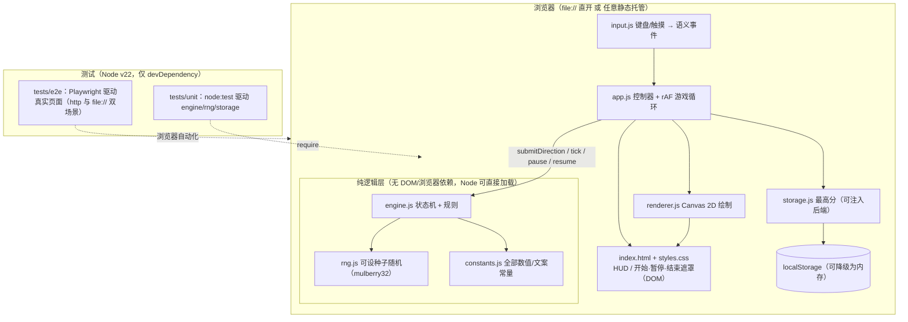
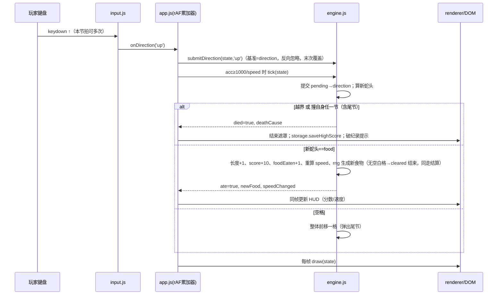

# 架构设计：单机版贪食蛇

- 版本：v1.1（按 [ARCH-REVIEW.md](./ARCH-REVIEW.md) 修复 B1/M1/M2/m1/m2）｜ 作者：architect（ai-dev-team 流水线）｜ 上游：[PRD.md](./PRD.md) v1.0
- 配套契约：[API.md](./API.md)（内部模块接口契约，前端与 QA 并行开发的唯一依据）

## 1. backend N/A 决议

**本项目不设 backend/ 目录，不设计任何 HTTP API。** 理由：PRD NFR-03 硬约束运行时零网络请求、A6 要求 `file://` 直开可玩、A4 无账号、FR-08 最高分仅存本机 localStorage。任何服务端进程都违背上述条款。`docs/API.md` 因此重定义为「内部模块接口契约」。`deploy/` 仅包含静态托管说明（可选 python3 静态服务器），无服务进程依赖。

## 2. 技术选型与 trade-off

**选定：原生 JavaScript（ES2020 语法，主流浏览器最新版均支持）+ Canvas 2D + 经典脚本（`<script src>` 非 module）+ UMD 式双端导出；运行时零依赖、零构建；测试用 Node v22 内置 `node:test`（unit）与 `@playwright/test@1.59.0`（e2e，本机缓存 chromium-1217 精确匹配）。**

| 备选 | 优点 | 否决理由 |
|------|------|----------|
| ES modules + 本地服务器（python3 http.server） | 原生 import/export，模块边界清晰 | Chrome 下 `file://` 加载 ES modules 被 CORS 拦截，违反 A6/NFR-03 硬约束；引入「必须先起服务器」门槛 |
| 单文件内联（全部 JS 写进 index.html） | 天然满足 file:// | 模块边界消失，核心逻辑无法在 Node 中独立加载，违反 NFR-06；QA 与前端无法并行 |
| 框架（React/Vue）+ 构建工具 | 生态成熟、UI 声明式 | 需要构建步骤与 node_modules 运行时产物，违背零构建/零网络约束；20×20 棋盘游戏复杂度不需要框架 |

选定方案的代价（如实记录）：无 import 依赖图，需靠**固定脚本加载顺序 + UMD 工厂注入依赖**维持模块边界（见 §4 与 API.md §1）；无类型检查，靠 API.md 的字段级契约 + 单元测试兜底。

## 3. 总体架构



职责边界（越界即设计违规）：
- **engine/rng/constants/storage 为纯逻辑**：不触碰 `window/document/localStorage` 全局；storage 的持久化后端由调用方注入（浏览器传 localStorage 包装，Node 传内存 Map），因此四个模块均可 `require` 进 Node 测试。
- **engine 不计时**：没有 setTimeout/rAF；节拍由 app.js 的累加器驱动，engine 只提供 `tick()`。随机数只经 `state.rngState` 流转，可复现。
- **renderer 只画棋盘/蛇/食物**：全部中文文案、分数、按钮、遮罩用 DOM（利于无障碍与 e2e 选择器）。
- **input 只翻译事件**：键位/触摸 → 语义回调，不含游戏规则；规则判定全部在 engine。
- **app.js 是唯一编排者**：持有唯一 GameState，连接循环、输入、渲染、存储、HUD。

## 4. 目录结构与加载顺序

```
snake-game/
├── README.md                  # 中文运行说明（file:// 直开 / 静态托管 / 跑测试）
├── package.json               # 仅 devDependency @playwright/test@1.59.0（精确版本）+ 测试脚本
├── docs/                      # PRD.md / ARCHITECTURE.md / API.md
├── frontend/                  # 运行时零依赖，双击 index.html 即玩
│   ├── index.html
│   ├── styles.css
│   └── js/                    # 经典脚本，index.html 中按此顺序加载：
│       ├── constants.js       # 1 无依赖
│       ├── rng.js             # 2 无依赖
│       ├── engine.js          # 3 依赖 constants、rng
│       ├── storage.js         # 4 无依赖（后端注入）
│       ├── renderer.js        # 5 依赖 constants（仅浏览器）
│       ├── input.js           # 6 无依赖（仅浏览器）
│       └── app.js             # 7 依赖以上全部（仅浏览器，DOMContentLoaded 后启动）
├── tests/
│   ├── unit/                  # node:test；rng.test.js / engine.test.js / storage.test.js
│   └── e2e/                   # playwright.config.js + game.spec.js（webServer 用 python3 http.server）
└── deploy/
    └── README.md              # 静态托管说明（可选），无服务端进程
```

UMD 式写法（每个文件统一模板，细节见 API.md §1）：工厂函数产出模块 API；检测到 `module.exports` 时走 CommonJS（依赖用 `require`），否则挂到 `globalThis.SnakeGame.<模块名>`（依赖从命名空间取）。浏览器与 Node 共用同一份源码，无构建。

## 5. 数据模型（GameState 摘要，字段级定义见 API.md §3）

唯一可变状态对象 `GameState`，由 app.js 持有、engine 原地修改：
- 棋盘 `width×height`（默认 20×20）；`snake: Cell[]` 头在 index 0，初始 3 节、头 (8,10)、向右。
- `direction`：**上一节拍已提交的方向**（蛇当前实际移动方向）；`pendingDirection: Direction|null`：本节拍待生效转向，**单槽位，至多一个**。
- `phase: 'ready'|'running'|'paused'|'over'`；`deathCause: null|'wall'|'self'|'cleared'`。
- `food: Cell|null`、`score`（10 的倍数）、`foodEaten`、`speed = min(4 + floor(foodEaten/5), 12)`（格/秒）、`tickCount`、`rngState`（uint32，随机可复现的关键）。
- 最高分不在 GameState 内，由 storage 模块管理（会话内存值 + 持久层）。

### 输入契约（FR-02，本项目最大风险，精确语义）

1. `submitDirection(state, dir)` 仅在 `phase==='running'` 受理；暂停/开始/结束界面方向键一律忽略（FR-06）。
2. **校验基准永远是 `state.direction`（本节拍已提交的方向），绝不用 `pendingDirection` 做基准。** `dir` 与基准相同或 180° 相反 → 忽略（返回 false）。
3. 通过校验的 `dir` **覆盖写入** `pendingDirection`（单槽位、最后一次有效按键生效），不建队列、不延迟到下节拍。
4. `tick()` 结算时：`direction = pendingDirection ?? direction`，随后清空 `pendingDirection`。
5. 验收对照：蛇向右，同节拍先 ↑ 后 ←：↑ 垂直于右 → pending=up；← 相对**已提交的右**是 180° 反向 → 忽略。结果仅 ↑ 生效，不会自撞。同节拍先 ↑ 后 ↓：两者均垂直于右 → 取最后的 ↓（蛇身水平，向下转向安全）。

## 6. 关键流程时序

一个移动节拍（含吃食物/死亡分支）：



- **开局**：加载 → storage.loadHighScore → createGame（phase='ready'，蛇/食物已生成）→ 显示开始遮罩 → 点击/回车/空格 → `start()` 置 running，累加器清零。
- **暂停/继续**：空格/P/按钮 → `pause()`（running→paused）；**暂停与恢复时 acc=0**，rAF 循环持续运行但仅 running 才累积时间 → 恢复瞬间不会连跳；暂停期间 submitDirection 直接拒绝。
- **死亡结算**：phase='over'；wall/self 保留死亡瞬间蛇形（不把碰撞格写入蛇身），cleared（填满棋盘）蛇头已写入、蛇填满棋盘；三种 deathCause 同走结算：若 score>会话最高分 → 更新并 storage.saveHighScore，显示破纪录中文提示。
- **重开**：结束界面按钮/回车/空格 → `createGame` 全新状态（URL 未指定 seed 时取新 seed）→ 直接 running，acc=0，无需刷新。
- **失焦（FR-12）**：window blur / visibilitychange(hidden) 且 running → 自动 pause；回来手动继续。
- **循环参数**：`dt = min(now-last, 250ms)` 钳制防螺旋；补拍循环写死 `while(acc >= interval && phase==='running'){ tick; acc -= interval; }`，`interval = 1000/state.speed` 每次迭代按当前 speed 重算（提速即时生效）；单帧补拍数 = ceil(250/interval)，「最多补 3 拍」仅对默认 maxSpeed=12 成立（Config 允许至 60）。

## 7. FR 承接映射（全覆盖）

| FR | 承接模块 | 要点 |
|----|----------|------|
| FR-01 开局 | app.js + engine.createGame/start + storage.loadHighScore + DOM 开始遮罩 | ≤3 次交互进局；回车/空格可开始 |
| FR-02 方向控制 | input.js（键位映射）+ engine.submitDirection/tick | §5 输入契约；unit 必测三条验收 |
| FR-03 移动/吃/长/分 | engine.tick + rng | 食物生成于空白格，可复现 |
| FR-04 死亡与结束 | engine.tick（判定）+ app.js（结算）+ storage.saveHighScore + DOM 结束遮罩 | 撞墙/咬自身（含尾节，见 §8）；破纪录提示 |
| FR-05 重开 | app.js（restart）+ engine.createGame | 分数/速度归零，最高分保留 |
| FR-06 暂停/继续 | engine.pause/resume + app.js（acc 清零）+ input.js | 暂停时方向键不生效 |
| FR-07 实时计分 | app.js HUD（DOM，tick 后同帧更新） | 当前分/最高分常显 |
| FR-08 最高分持久化 | storage.js（注入后端 + try/catch 降级） | 不可用时退化为会话内存值，游戏照常 |
| FR-09 加速 | engine.tick（speed 重算）+ app.js HUD「速度 xN」 | 4→12，每 5 食物 +1 |
| FR-10 触摸滑动（P1） | input.bindTouch + engine.submitDirection | 同一输入契约；touch-action:none 防滚动 |
| FR-11 移动布局（P1） | styles.css + renderer.resize + DOM 屏上按钮 | 竖屏自适应，无键盘可完成闭环 |
| FR-12 失焦暂停（P1） | app.js（blur/visibilitychange → pause） | 回前台手动继续 |

## 8. 风险、边界决议与备选

| # | 风险/边界 | 决议 |
|---|-----------|------|
| R1 | 输入时序缺陷致「莫名自撞」（PRD 最大风险） | §5 契约写死校验基准与单槽位语义；unit 覆盖三条 Given/When/Then + 边界表（API.md §3.4）；e2e 真实键盘复验 |
| R2 | `file://` 下 localStorage 可能抛异常 | storage 构造时探测 + 每次读写 try/catch，降级内存；e2e 用 addInitScript 模拟抛异常验证 FR-08 |
| R3 | `file://` 下 ES modules 被 CORS 拦截 | 经典脚本 + UMD（§2 已否决 modules 方案）；e2e 增加 file:// 直开用例 |
| R4 | 暂停/后台恢复后时间累积连跳 | pause/resume/start/restart 一律 acc=0；dt 钳制 250ms；FR-12 失焦自动暂停 |
| R5 | 自撞是否含「即将让位的尾节」 | **按 PRD FR-04 字面：与自身任一节（含尾节）重合即死**，比部分经典实现更严格；已在 API.md 写明，QA 按此断言。若评审要求放宽为「尾节让位则不死」，仅改 engine 一处并同步契约 |
| R6 | 蛇填满棋盘（PRD 未定义） | 按「通关」结束：deathCause='cleared'，moved/ate/died=true、newFood=null、rngState 不变（不调 nextInt），与 wall/self 同走最高分结算（取值写死于 API §3.1/3.4/3.5） |
| R7 | 最高分何时刷新显示 | 按 FR-04 字面：死亡结算时更新存储与显示；游玩中 HUD 最高分保持会话纪录值 |
| R8 | e2e 食物位置不可预测 | URL `?seed=<uint32>` 注入随机种子（校验 /^\d+$/ 且 ≤4294967295，超限忽略）+ `window.SnakeGame.debug.getState()` 只读快照钩子（见 API.md §7） |
| R9 | 按钮焦点 × Enter 默认行为（评审 B1） | 双保险：bindKeyboard 对 Enter preventDefault + 所有按钮 click 处理后立即 blur()（API §7）；e2e 必测焦点冲突路径（§9） |

备选回退：若 UMD 双端导出在实现中被证明繁琐，可退化为「纯逻辑层单文件 IIFE + Node 侧 vm 加载」，但会牺牲模块粒度，默认不采用。

## 9. 测试与交付

- `npm run test:unit`：`node --test tests/unit/`，零依赖，直接 require 纯逻辑层；必测：输入契约三条验收与边界表、撞墙/自撞（含尾节）、吃食物生长计分、速度 4→12 封顶、种子复现、存储降级、cleared 拍全字段取值与 rngState 不变（API §3.5 短路）。
- `npm run test:e2e`：Playwright（chromium-1217），webServer 用 `python3 -m http.server` 服务 frontend/；另含 file:// 直开与 localStorage 异常注入用例。**必测焦点冲突路径（B1）：鼠标点暂停按钮→继续→死亡→Enter 重开，断言新局必须处于 running**；FR-01/FR-08 开始界面最高分统一断言 `#hud-high`；HUD 全 phase 常显、遮罩仅覆盖棋盘区不覆盖 HUD（M2）。
- 交付物全部位于 `snake-game/`；README 中文说明三种运行方式（双击 index.html / 静态托管 / 跑测试）。